# Court List Publishing Service — Application Guide

> **Service:** `cp-court-list-publishing-service` · **Platform:** HMCTS Common Platform (Crime)
> **Audience:** business stakeholders, product owners, developers, QA / testers, support engineers
> **Base path:** `/courtlistpublishing-service` · **Default port:** `8082`

This guide explains what the Court List Publishing Service does, who uses it, how it works inside, and how to build, test and operate it. Each part is labelled with the audience it is written for, so you can skip to what matters to you.

Diagrams use [Mermaid](https://mermaid.js.org/). They render automatically on GitHub and in the HTML version of this guide (`court-list-publishing-service.html` in this folder).

---

## Contents

1. [At a glance](#1-at-a-glance) — *everyone*
2. [Business guide](#2-business-guide) — *business stakeholders, product owners*
3. [Architecture](#3-architecture) — *developers, architects*
4. [Key flows, step by step](#4-key-flows-step-by-step) — *developers, QA*
5. [Status lifecycle](#5-status-lifecycle) — *everyone*
6. [API reference](#6-api-reference) — *developers, QA, consuming teams*
7. [Data model](#7-data-model) — *developers, QA*
8. [Security and access control](#8-security-and-access-control) — *everyone*
9. [Configuration](#9-configuration) — *developers, operations*
10. [Developer guide](#10-developer-guide) — *developers*
11. [QA and testing guide](#11-qa-and-testing-guide) — *QA, developers*
12. [Operations and support](#12-operations-and-support) — *support, operations*
13. [CI/CD pipeline](#13-cicd-pipeline) — *developers, operations*
14. [Glossary](#14-glossary) — *everyone*

---

## 1. At a glance

*For everyone.*

Courts publish **court lists**: the schedule of hearings for a court on a given day. Some lists are for the public, some for the press, and some for court staff, prisons and other justice partners.

The Court List Publishing Service is the part of Common Platform that:

1. **Collects** the hearing data for a court list from the Listing and Progression services.
2. **Transforms** it into the agreed publication format, removing unsafe content and checking it against a schema.
3. **Publishes** it to **CaTH** (Courts and Tribunals Hearings), the GOV.UK service where the public and the press view court lists.
4. **Generates a PDF** of the list and stores it in Azure Blob Storage so staff can download it later.
5. **Generates on-demand downloads** (PDF or Word) of many list types for court staff.
6. **Publishes Single Justice Procedure (SJP) lists**, the national lists of minor cases decided on the papers, to CaTH.
7. **Tracks** the publish and file status of every list so users and support teams can see whether it worked.

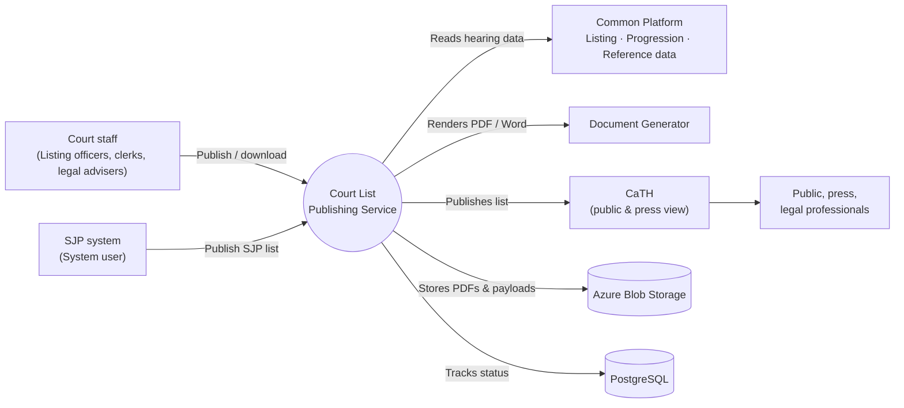

| Question | Short answer |
|---|---|
| What triggers a publish? | A user (via the Common Platform UI) or a system user calls the publish API. |
| Is publishing instant? | The request is accepted immediately; the work (data fetch, CaTH send, PDF) runs in the background a few moments later. |
| Which lists go to CaTH? | **Magistrates' Standard** and **Online Public** lists, plus the **SJP** public and press lists (full and delta, English and Welsh). |
| Where do PDFs go? | Azure Blob Storage, downloadable via `/api/files/download/{fileId}`. |
| What if I publish the same list twice? | The existing record for that court, date and list type is reused and re-processed. The latest attempt overwrites the previous one. |
| Who can do what? | Controlled by user groups (see [Section 8](#8-security-and-access-control)). |

---

## 2. Business guide

*For business stakeholders and product owners.*

### 2.1 Who uses the service

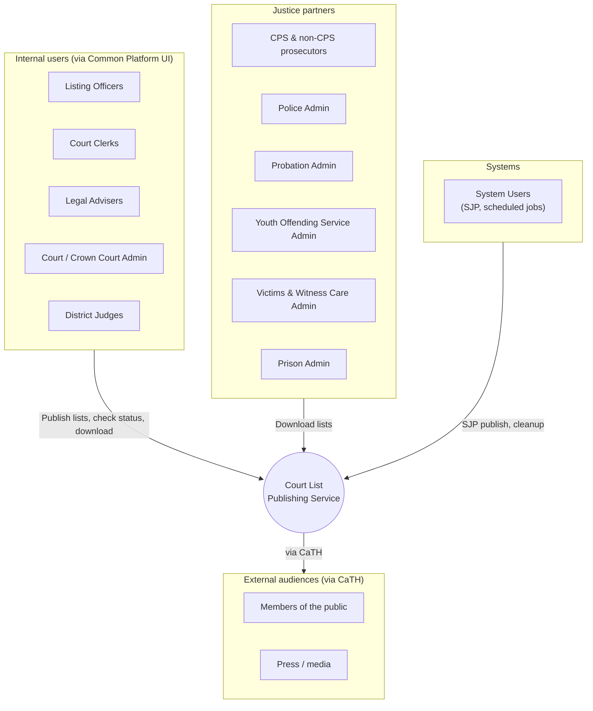

### 2.2 What the service delivers

| Capability | Business value |
|---|---|
| **Publish to CaTH** | Open justice: hearing lists are visible to the public and press on GOV.UK without manual uploads. |
| **Stored PDF per published list** | A durable record of exactly what was published, available for staff download. |
| **On-demand downloads** | Staff and partners get the list they need (public, standard, bench, judge, ushers, prison, Crown daily/firm, and more) in PDF or Word. |
| **Welsh language support** | Welsh courts get bilingual templates, and CaTH receives the `WELSH` language flag. |
| **Reporting-restriction aware** | Restricted information is filtered out for audiences that must not see it ("restricted" lists). |
| **SJP national lists** | Daily public and press lists of Single Justice Procedure cases, in full and delta (changes only) forms. |
| **Status tracking** | Every list shows whether the publish and the PDF succeeded or failed, with the error recorded for support. |
| **Automatic housekeeping** | Records and files older than the retention period (default **90 days**) are removed. |

### 2.3 Court list types

| List type | Audience | Published to CaTH | Stored PDF on publish | Downloadable | Download format |
|---|---|:-:|:-:|:-:|---|
| `STANDARD` | Court staff and partners (classified) | ✅ `MAGISTRATES_STANDARD_LIST` | ✅ | ✅ | PDF |
| `ONLINE_PUBLIC` | Public (online) | ✅ `MAGISTRATES_PUBLIC_LIST` | ✅ | ✅ (Crown) | PDF |
| `PUBLIC` | Public (printed / notice board) | — | — | ✅ | PDF |
| `BENCH` | Magistrates' bench | — | — | ✅ | PDF |
| `ALPHABETICAL` | Court staff | — | — | ✅ | PDF |
| `JUDGE` | Judiciary | — | — | ✅ | PDF |
| `USHERS_CROWN` | Ushers (Crown Court) | — | — | ✅ | **Word** |
| `USHERS_MAGISTRATE` | Ushers (magistrates') | — | — | ✅ | **Word** |
| `PRISON` | Prisons | — | — | ✅ (dedicated endpoint) | PDF |
| `DRAFT` / `FINAL` | Crown Court daily list | — | — | ✅ (Crown) | PDF |
| `FIRM` | Crown Court firm (week-commencing) list | — | — | ✅ (Crown) | PDF |
| `SJP_*` (8 variants) | Public / press, national | ✅ | — (no file) | — | — |

> **Business rule:** only `STANDARD` and `ONLINE_PUBLIC` have a CaTH mapping and a stored-PDF template. Publishing any other list type through the standard publish endpoint records the publish as **FAILED** ("Unsupported court list type") and the file as **FAILED** ("No PDF template").

### 2.4 Business rules

| # | Rule |
|---|---|
| BR-1 | A court list is identified by **court centre + publish date + list type**. There is at most one tracking record per combination. |
| BR-2 | A publish request must have **start date = end date** (a single day). |
| BR-3 | Re-publishing an existing list resets its status to `REQUESTED` and runs the whole process again; the newest attempt is what CaTH shows. |
| BR-4 | A late failure never hides an earlier success: if a list already reached CaTH (or its PDF was stored), a slower failing attempt does not overwrite `SUCCESSFUL` with `FAILED`. |
| BR-5 | CaTH displays a magistrates' list from the moment it is published until **23:59 UTC on the publish date**. |
| BR-6 | SJP lists are **national**: they have no court centre. They are displayed for **24 hours** from publication. |
| BR-7 | Public lists are sent with sensitivity `PUBLIC`; standard and press lists are sent as `CLASSIFIED`. |
| BR-8 | Welsh courts use Welsh/bilingual templates and the CaTH language `WELSH`. |
| BR-9 | Prison lists can only be downloaded through the dedicated prison endpoint, by prison-list roles. |
| BR-10 | Data (status records, PDFs, CaTH payload copies) older than the retention period (default 90 days) is deleted by the cleanup job. |
| BR-11 | Text that the Azure Web Application Firewall would block (by default `..\` and `../`) is stripped from published content, so a legitimate list is not rejected at the gateway. |

### 2.5 The publishing journey (business view)

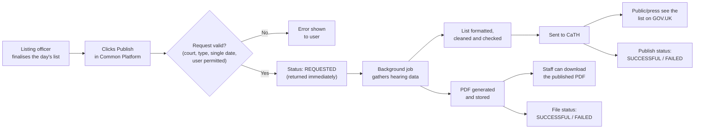

### 2.6 SJP list variants

The SJP system sends four list types, each in English or Welsh, so there are eight daily publications:

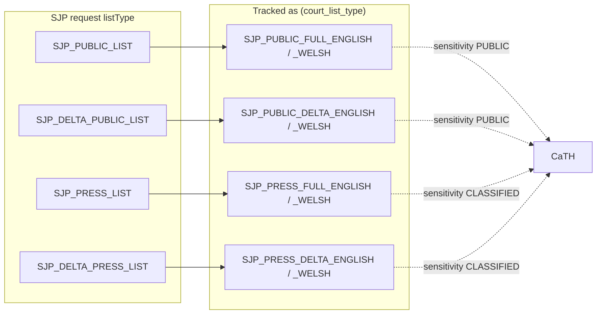

- **Full** lists contain every ready case; **delta** lists contain only the changes since the last send.
- **Press** lists include extra detail (e.g. reporting restrictions per offence) and are `CLASSIFIED`.

---

## 3. Architecture

*For developers and architects.*

### 3.1 Technology stack

| Area | Technology |
|---|---|
| Language / runtime | Java 25 (Gradle toolchain), Eclipse Temurin 25 JRE container |
| Framework | Spring Boot 4 (Web MVC, Data JPA, Actuator, AspectJ, OpenTelemetry) |
| API contract | OpenAPI-generated interfaces from `uk.gov.hmcts.cp:api-cp-crime-court-list-publisher` |
| Background jobs | `uk.gov.hmcts.cp:task-manager-service` (DB-backed job queue + scheduled executor) |
| Database | PostgreSQL 16, Flyway migrations, Hibernate in `validate` mode |
| Storage | Azure Blob Storage (Azure SDK, JDK HTTP client) |
| Identity to CaTH | Azure AD client credentials (Azure Identity) via Azure API Management (APIM) |
| Authorisation | `cp-auth-rules-filter` + Drools rules (`acl/court-list-publishing-rules.drl`) |
| Auditing | `cp-audit-filter-springboot` (Artemis JMS) |
| Validation | `networknt` JSON Schema validator; OWASP encoder for log safety |
| Observability | Logback JSON (logstash encoder), Micrometer/Prometheus, OTLP tracing, App Insights agent |
| Testing | JUnit 6, Mockito, Spring Boot Test, Testcontainers, WireMock, Azurite, Pact |
| Quality | PMD, CodeQL, OWASP ZAP baseline, secrets scanner, CycloneDX SBOM |

### 3.2 System context

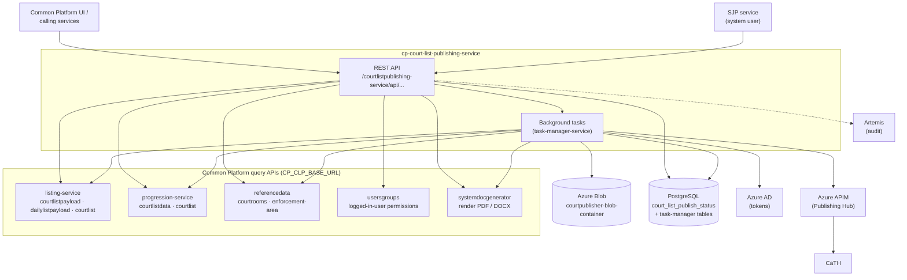

### 3.3 Internal components

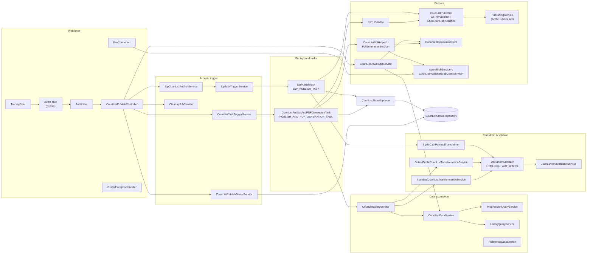

`*` = bean exists only when `azure.storage.enabled=true` (`AZURE_STORAGE_ENABLED`).

### 3.4 Package layout

| Package (`uk.gov.hmcts.cp.…`) | Responsibility |
|---|---|
| `controllers` | REST controllers implementing the generated OpenAPI interfaces; global exception handling |
| `services` | Business logic: data fetch, transformation, CaTH publishing, PDF, blob, status |
| `services.sjp` | SJP accept, list-type mapping, task trigger, CaTH payload transformer |
| `services.sanitization` | `DocumentSanitizer`, HTML stripping, WAF-pattern stripping, required-field registry |
| `services.courtlistdownload` | On-demand PDF/Word download generation |
| `task` | Background tasks registered with task-manager (`@Task(...)`) and job-data keys |
| `domain` | JPA entity `CourtListStatusEntity`, `DtsMeta` (CaTH headers), SJP CaTH model |
| `models` | Inbound upstream payload models (`CourtListPayload`, `Hearing`, `Defendant`, …) |
| `models.transformed` | Outbound CaTH publication models (`CourtListDocument`, `schema.*`) |
| `repositories` | Spring Data repository for publish status |
| `acl` | Security group and permission constants used by Drools rules |
| `config` | Azure, REST, JPA, CORS, audit, task-manager, ObjectMapper and OpenAPI configuration |
| `cleanup` | Retention cleanup of status rows and blobs |
| `filters.tracing` | Request tracing / MDC filter |

### 3.5 Key design decisions

| Decision | Why |
|---|---|
| **API-first** — controllers implement interfaces from a separate spec artifact | One contract shared with consumers; Pact verifies it. API changes start in the spec repo. |
| **Asynchronous processing** via task-manager-service | CaTH, document generation and upstream queries can be slow; the user gets an immediate `REQUESTED` response. |
| **Tasks always complete** (`COMPLETED`), with failures recorded on the status row | Avoids blind retries that could double-publish; failures are visible and alertable (`PUBLISHING_FAILED`). |
| **Shared status table for standard and SJP** | One place to track all publications; SJP rows have no court centre or file (enforced by CHECK constraints). |
| **Sanitise then schema-validate before sending** | CaTH and the Azure WAF reject bad payloads; catching that early gives clearer errors. |
| **Pluggable `CourtListPublisher`** | The real `CaTHPublisher` goes through APIM; the `integration` profile swaps in `StubCourtListPublisher` that posts to WireMock. |
| **Optional Azure storage** | Beans that need storage are conditional, so the service can run without it (e.g. some local setups). |

---

## 4. Key flows, step by step

*For developers and QA.*

### 4.1 Standard publish (STANDARD / ONLINE_PUBLIC)

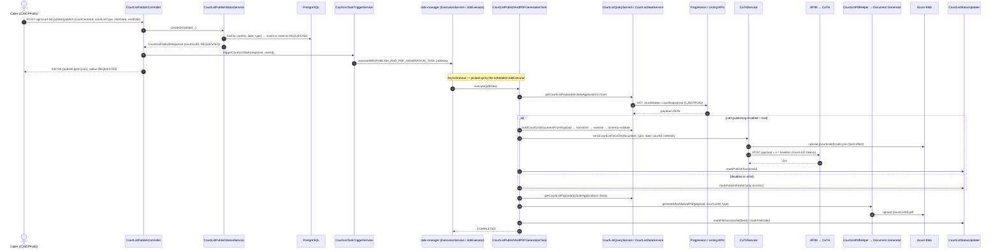

**Notes**
- The task fetches the payload twice: once *with* applications (for CaTH) and once *without* (for the PDF).
- If `CATH_PUBLISHING_ENABLED=false`, the CaTH step is skipped and the **publish status stays `REQUESTED`**. The PDF is still generated.
- A failure in one step does not stop the next step; each is recorded separately.

### 4.2 Transform → sanitise → validate → publish

```mermaid
flowchart LR
    P["CourtListPayload<br/>(from Progression/Listing)"] --> D{"courtListType?"}
    D -- ONLINE_PUBLIC --> T2["OnlinePublicCourtList<br/>TransformationService"]
    D -- other --> T1["StandardCourtList<br/>TransformationService"]
    T1 & T2 --> DOC["CourtListDocument"]
    DOC --> S1["HtmlStrippingSanitizer"]
    S1 --> S2["WafPatternSanitizer<br/>(strip CATH_WAF_BLOCKED_PATTERNS)"]
    S2 --> S3["RequiredStringFieldsRegistry<br/>(keep required fields present)"]
    S3 --> V{"JSON schema valid?<br/>standard / online-public"}
    V -- No --> E["SchemaValidationException<br/>→ publish FAILED"]
    V -- Yes --> M["Map type → CaTH list type<br/>& sensitivity"]
    M --> H["Build DtsMeta headers"]
    H --> B["Upload copy to blob<br/>{id}-cath.json"]
    B --> C["CourtListPublisher.publish"]
```

**CaTH metadata headers** (built by `CaTHService`, sent by `PublishingService`):

| Header | Value (standard flow) |
|---|---|
| `x-provenance` | `COMMON_PLATFORM` |
| `x-type` | `LIST` |
| `x-list-type` | `MAGISTRATES_STANDARD_LIST` or `MAGISTRATES_PUBLIC_LIST` |
| `x-court-id` | Numeric court id from reference data, or `0` |
| `x-content-date` | Publish date (ISO date-time) |
| `x-language` | `ENGLISH` or `WELSH` |
| `x-sensitivity` | `CLASSIFIED` (standard) or `PUBLIC` (online public) |
| `x-display-from` | Now (UTC) |
| `x-display-to` | Publish date 23:59 UTC |
| `Authorization` / `external-service-access-token` | Azure AD tokens (local & remote app registrations) |

### 4.3 SJP publish

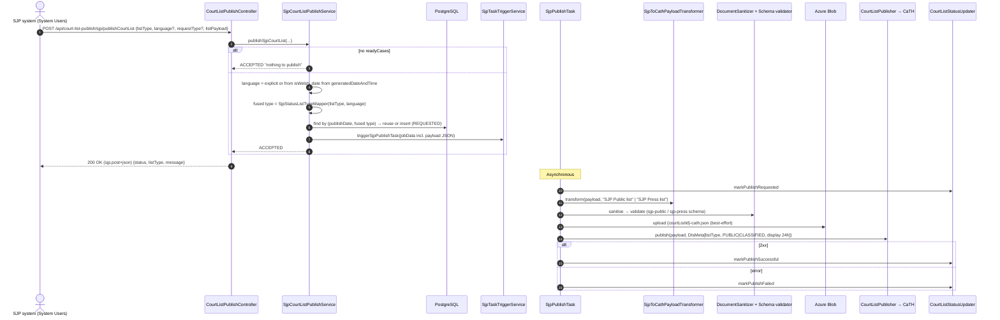

### 4.4 On-demand download routing

`GET /api/court-list-publish/download` chooses how to produce the document:

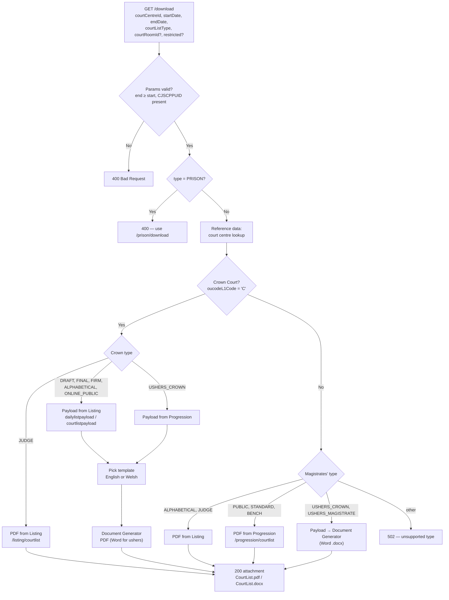

**Crown Court templates**

| Type | English template | Welsh template |
|---|---|---|
| `DRAFT`, `FINAL` | `CrownDailyList` | `CrownDailyListWelsh` |
| `FIRM` | `CrownFirmList` | `CrownFirmListWelsh` |
| `ONLINE_PUBLIC` | `CrownOnlinePublicCourtList` | `CrownOnlinePublicCourtListWelsh` |
| `ALPHABETICAL` | `CourtList` | `CourtListEnglishWelsh` |
| `USHERS_CROWN` | `UshersCrownList` | `UshersCrownList` |

**Stored-PDF templates (publish flow)**: `STANDARD` → `BenchAndStandardCourtList`; `ONLINE_PUBLIC` → `OnlinePublicCourtList` (Welsh: `OnlinePublicCourtListEnglishWelsh`).

### 4.5 Retention cleanup

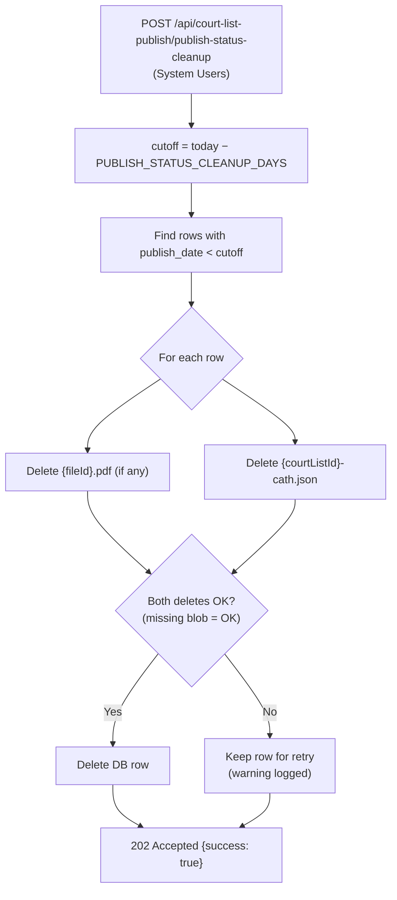

---

### 4.6 Crown publish (FINAL / WARN / FIRM)

Publishes a **Crown court** list to CaTH in the format of one of three HMCTS schemas
(`crown_daily_list`, `crown_advance_list`, `crown_firm_list`, copied from
`pip-data-management` into `src/main/resources/schema/`). The endpoint is
`POST /api/court-list-publish/crown/publish` with the same request body as the standard publish
(`courtCentreId`, `courtListType`, `startDate`, `endDate`) and the media type
`application/vnd.courtlistpublishing-service.crown.post+json`. The `courtListType` chooses the schema:

| `courtListType` | Crown list | JSON root | CaTH `x-list-type` | Listing query |
|---|---|---|---|---|
| `FINAL` | Daily | `DailyList` | `CROWN_DAILY_LIST` | `startDate` / `endDate` |
| `WARN` | Advance | `WarnedList` | `CROWN_ADVANCE_LIST` | `weekCommencingStartDate` / `weekCommencingEndDate` |
| `FIRM` | Firm | `FirmList` | `CROWN_FIRM_LIST` | `weekCommencingStartDate` / `weekCommencingEndDate` |

Any other `courtListType` (including `DRAFT`, which is never sent to CaTH) is rejected with `400`. The task fails the publish, recording `FAILED` on the row, when the court centre is not a Crown court (`oucodeL1Code` ≠ `C`), has no reference data, or has no numeric court id in reference data or the payload; it also records `FAILED` when `cath.publishing-enabled=false`, so the row never stays `REQUESTED`. Restricted (`restrictFromCourtList` or `shadowListed`) hearings are dropped; a masked defendant carries only the masked name and URN, with no charges, custody status or counsel. Unlike the standard publish, `startDate` and `endDate` may differ
(a week for WARN and FIRM); the status row is keyed on the start date. There is no PDF, so the row's file status is
null, as it is for SJP.

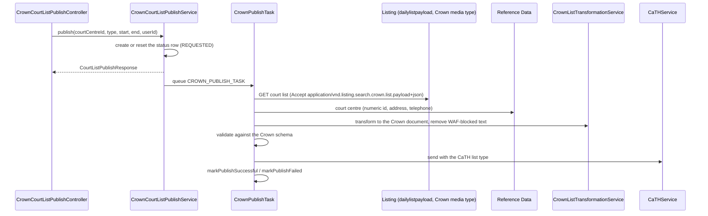

The listing context returns its daily list payload plus linked cases, sitting notes, judge name parts and further court
address details for the Crown media type. The transformers (`services/crown/`) take values from that payload and
reference data. What the data does not hold is left out where the schema allows, and the following apply where the
schema requires a value:

- `CaseNumberCaTH` is a copy of the case number (or the application reference) until a real source exists.
- A sitting with no judiciary yet gets the judge surname `To be allocated`; a court room name with no number gets court
  room number `0`; a defendant with no last name gets the surname `Unknown`.
- Hearings the court has restricted from the list are left out, and restricted defendants are masked (`******`,
  `IsMasked: yes`) with no date of birth or address.
- Firm list reserve entries are left out when the case number does not match the shape the schema requires for them
  (`^[A-Z][0-9]{8}$`); a warning is logged with the count.
- Not available from the data, so absent: sex, prisoner id and location, date-of-birth verification, prosecution
  advocate, `Section53`, listing instructions and the three-letter hearing type codes.
- CaTH is told sensitivity `CLASSIFIED` and language `ENGLISH`.

## 5. Status lifecycle

*For everyone.*

Each tracked list has two independent statuses: **publish status** (did it reach CaTH?) and **file status** (was the PDF stored?). SJP rows have only a publish status.

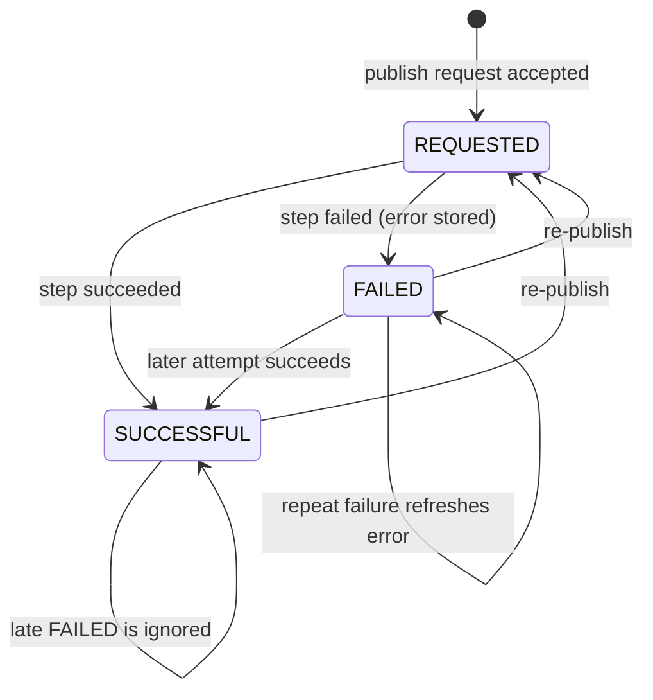

| Status | Meaning | What to do |
|---|---|---|
| `REQUESTED` | Accepted, work pending or in progress. For publish status it also means **CaTH publishing is disabled** in this environment. | Wait, then re-check. If it stays here, check `CATH_PUBLISHING_ENABLED` and the job executor. |
| `SUCCESSFUL` | Reached CaTH / PDF stored (`fileId` set, `publish_count` incremented). | None. |
| `FAILED` | The step failed. The full stack trace is in `publish_error_message` / `file_error_message`. | Investigate the error; re-publish once fixed. |

> **Rule:** `CourtListStatusUpdater.shouldRecord` refuses exactly one transition — writing `FAILED` over `SUCCESSFUL` — so attempts finishing out of order cannot hide a list that is live.

---

## 6. API reference

*For developers, QA and consuming teams.*

All paths are relative to `/courtlistpublishing-service`. The source of truth is the OpenAPI spec in `api-cp-crime-court-list-publisher` (version set by `apiSpecVersion` in `gradle.properties`).

| Method | Path | Purpose | Drools action | Allowed |
|---|---|---|---|---|
| `POST` | `/api/court-list-publish/publish` | Create/refresh a publish record and queue the publish + PDF task | `courtlistpublishing-service.publish.post` | Users with permission *Court List / Publish* |
| `GET` | `/api/court-list-publish/publish-status` | Query publish status by `courtListId`, or `courtCentreId` + `publishDate` (+ optional `courtListType`) | `courtlistpublishing-service.publish.get` | Publishing roles |
| `GET` | `/api/court-list-publish/download` | On-demand PDF/Word for a court list | `courtlistpublishing-service.download.get` | Publishing roles |
| `GET` | `/api/court-list-publish/prison/download` | Prison court list PDF | `courtlistpublishing-service.prison-download.get` | Prison-list roles |
| `POST` | `/api/court-list-publish/crown/publish` | Queue a Crown court list for CaTH in one of the three Crown schemas (chosen by `courtListType`); see [4.6](#46-crown-publish-draft--final--warn--firm) | `courtlistpublishing-service.crown.post` | Users with permission *Court List / Publish* |
| `POST` | `/api/court-list-publish/sjp/publishCourtList` | Accept and queue an SJP list for CaTH | `courtlistpublishing-service.sjp.post` | System Users |
| `POST` | `/api/court-list-publish/publish-status-cleanup` | Delete data older than the retention period | `courtlistpublishing-service.publish-status-cleanup` | System Users |
| `GET` | `/api/files/download/{fileId}` | Download a stored PDF (`{fileId}.pdf`) | `courtlistpublishing-service.files.download` | Publishing roles |
| `GET` | `/actuator/health`, `/actuator/info`, `/actuator/prometheus` | Health and metrics | excluded from authz | — |

**Common headers**

| Header | Required | Notes |
|---|---|---|
| `CJSCPPUID` | Yes (publish, download, prison download) | Calling user's id; forwarded to upstream services and used for permission checks. |
| `Accept` / `Content-Type` | Yes | Vendor media types, e.g. `application/vnd.courtlistpublishing-service.publish.post+json`, `…publish.get+json`, `…sjp.post+json`, `…crown.post+json`, `…publish-status-cleanup+json`. |

**Example — publish request**

```http
POST /courtlistpublishing-service/api/court-list-publish/publish
CJSCPPUID: 7aee5dea-b0de-440e-a24b-cc8a5d3a8b6e
Content-Type: application/vnd.courtlistpublishing-service.publish.post+json

{
  "courtCentreId": "f8254db1-1683-483e-afb3-b87fde5a0a26",
  "courtListType": "STANDARD",
  "startDate": "2026-10-16",
  "endDate": "2026-10-16"
}
```

**Response (200)** — fields of `CourtListPublishResponse`: `courtListId`, `courtCentreId`, `publishStatus`, `fileStatus`, `courtListType`, `lastUpdated`, `fileUrl`, `fileId`, `publishErrorMessage`, `fileErrorMessage`, `publishDate`.

**Error responses**

| Status | When |
|---|---|
| `400` | Missing body/fields, start ≠ end (publish), end < start (download or Crown publish), missing `CJSCPPUID`, `PRISON` on the general download, a `courtListType` with no Crown schema (Crown publish) |
| `401/403` | Authorisation filter denies the action (when authz enabled) |
| `404` | `/api/files/download/{fileId}` — file not found |
| `502` | Download: upstream (Listing/Progression/Document Generator) failed or type unsupported |
| `500` | Failure queueing the background task |

---

## 7. Data model

*For developers and QA.*

The service owns one table, `court_list_publish_status`. The task-manager library manages its own job tables in the same database.

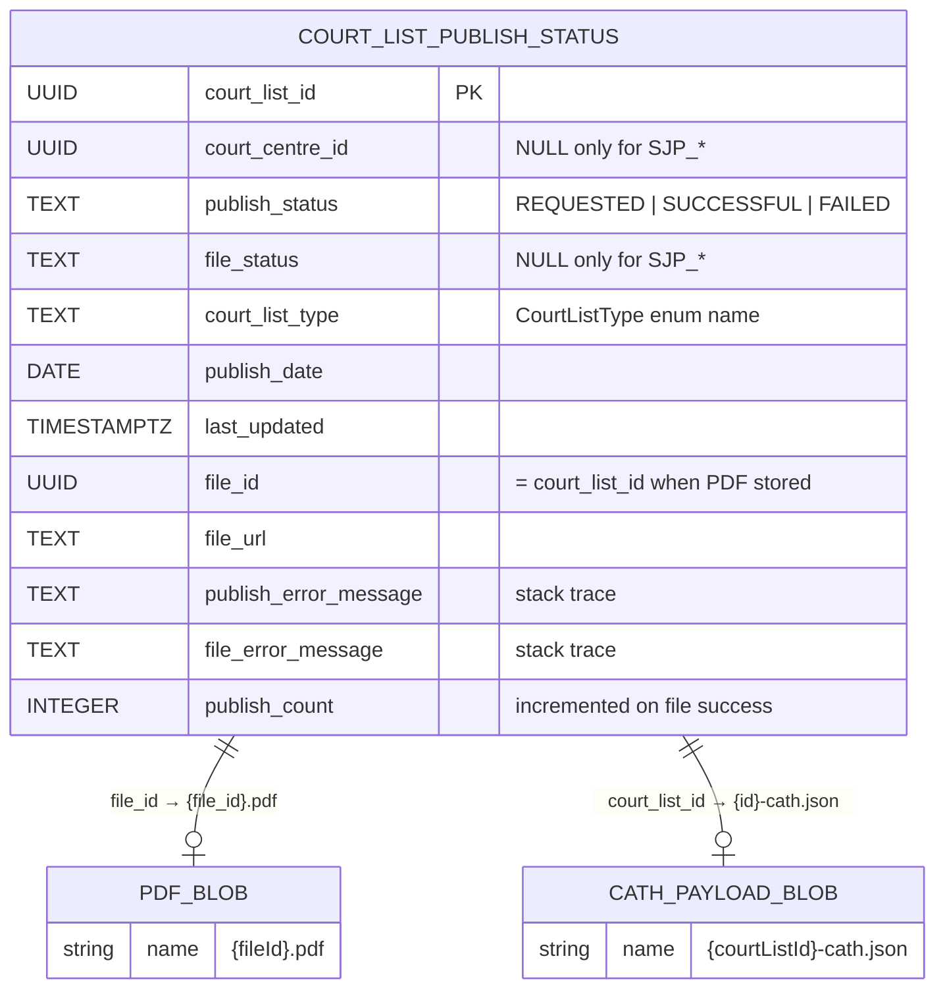

**Constraints and indexes**

| Name | Rule |
|---|---|
| `ck_court_centre_id_required_for_non_sjp` | `court_centre_id` must be set unless `court_list_type` starts with `SJP_` |
| `ck_file_status_required_for_non_sjp` | `file_status` must be set unless `court_list_type` starts with `SJP_` |
| `ux_court_list_publish_status_non_sjp` | Unique `(court_centre_id, publish_date, court_list_type)` where centre is not null |
| `ux_court_list_publish_status_sjp` | Unique `(publish_date, court_list_type)` where centre is null |

**Migrations** (`src/main/resources/db/migration`)

| Version | Change |
|---|---|
| `V1001` | (Re)create `court_list_publish_status` |
| `V1002` | Add `publish_count` |
| `V1003` | Allow SJP rows (nullable centre/file status, CHECK constraints, partial unique indexes) |

---

## 8. Security and access control

*For everyone; detail for developers.*

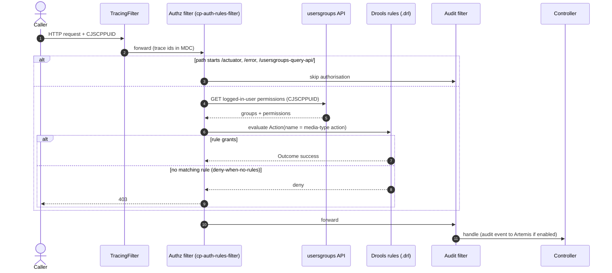

**Groups**

| Group set | Members | Grants |
|---|---|---|
| **Publish permission** | Any user holding permission `{object: "Court List", action: "Publish"}` | `publish.post` |
| **Publishing roles** | Listing Officers, Court Clerks, Legal Advisers, Crown Court Admin, Court Administrators, Youth Offending Service Admin, CPS, Probation Admin, Victims & Witness Care Admin, Police Admin, Court Associate, Non CPS Prosecutors, District Judge, System Users | `publish.get`, `download.get`, `files.download`, `public-court-list.get` |
| **Prison-list roles** | Prison Admin, Listing Officers, Legal Advisers, Court Clerks, CTSC Admin, Operational Delivery Admin | `prison-download.get` |
| **System users only** | System Users | `sjp.post`, `publish-status-cleanup` |

**Other protections**

- Authz and audit filters are **off by default** (`CP_CLP_AUTHZ_ENABLED`, `CP_CLP_HTTP_AUDIT_ENABLED`, `CP_CLP_AUDIT_ENABLED`) and switched on per environment.
- Outbound CaTH calls use Azure AD client-credential tokens; no secrets are stored in the repo (secrets are mounted at `/mnt/secrets/rpe/`).
- Log messages built from user input are encoded with the OWASP encoder (`Encode.forJava`).
- Published content is HTML-stripped and WAF-sanitised before it leaves the service.
- CI runs CodeQL, PMD, an OWASP ZAP baseline scan and a secrets scanner.

---

## 9. Configuration

*For developers and operations.*

`application.yaml` imports one file per concern (`application-datasource.yml`, `-server-management`, `-azure`, `-jwt`, `-authz`, `-audit`). Every value can be overridden by an environment variable.

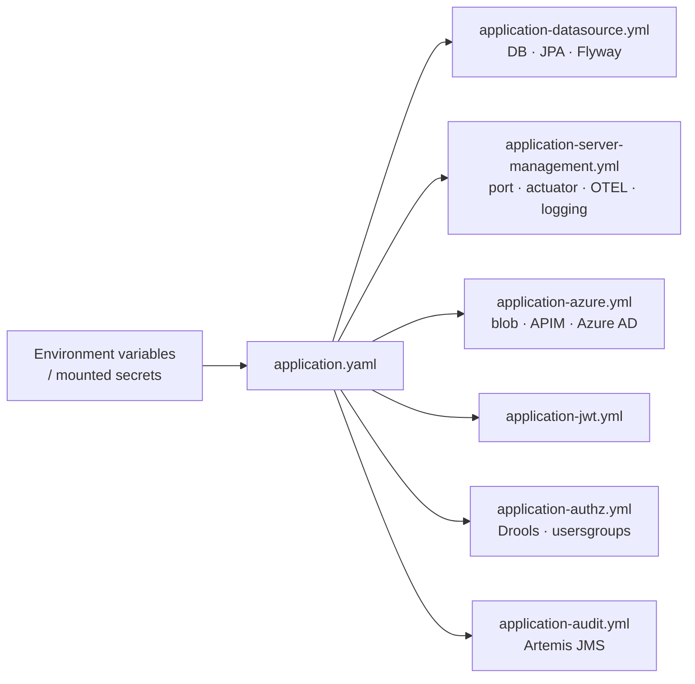

| Variable | Default | Purpose |
|---|---|---|
| `SERVER_PORT` | `8082` | HTTP port |
| `CP_CLP_DATASOURCE_URL` / `_USERNAME` / `_PASSWORD` | `jdbc:postgresql://localhost:55432/courtlistpublishing` / `courtlistpublishing` | Database |
| `CP_CLP_BASE_URL` | `http://localhost:8080` | Common Platform query APIs base URL |
| `COURTLISTPUBLISHING_SYSTEM_USER_ID` | — | System user id for background upstream calls |
| `CATH_PUBLISHING_ENABLED` | `false` | Turn CaTH publishing on/off |
| `CATH_BASE_URL` / `CATH_ENDPOINT` | `http://localhost:8080` / `/courtlistpublisher/publication` | CaTH endpoint (stub/integration) |
| `CATH_WAF_BLOCKED_PATTERNS` | `..\,../` | Substrings removed from payloads; empty disables |
| `AZURE_STORAGE_ENABLED` | `false` | Enables blob storage, PDF generation and file download beans |
| `AZURE_STORAGE_ACCOUNT_NAME` / `_KEY` / `_CONTAINER_NAME` | — / — / `courtpublisher-blob-container` | Blob storage |
| `AZURE_LOCAL_DTS_APIMURL`, `AZURE_LOCAL_DTS_*`, `AZURE_REMOTE_DTS_*` | — | APIM URL and Azure AD app registrations for CaTH |
| `AZURE_CLIENT_ID`, `AZURE_TENANT_ID` | — | Azure identity |
| `CP_CLP_AUTHZ_ENABLED` | `false` | Drools authorisation filter |
| `CP_CLP_HTTP_AUDIT_ENABLED`, `CP_CLP_AUDIT_ENABLED` | `false` | Audit filter / Artemis |
| `PUBLISH_STATUS_CLEANUP_DAYS` | `90` | Retention period |
| `OTEL_METRICS_ENABLED`, `OTEL_TRACES_URL`, `OTEL_METRICS_URL` | `false` | Tracing/metrics export |
| `VIRTUAL_THREADS` | `false` | Java virtual threads |

---

## 10. Developer guide

*For developers.*

### 10.1 Prerequisites

- JDK 25 (Gradle toolchain will provision it if configured), Docker (Desktop or engine), `direnv` (optional, loads `.env` via `.envrc`).

### 10.2 Common commands

```bash
./gradlew bootJar                       # build the jar
./gradlew test                          # unit tests (Pact-tagged tests excluded)
./gradlew test --tests 'uk.gov.hmcts.cp.services.CaTHServiceTest'          # one class
./gradlew test --tests 'uk.gov.hmcts.cp.services.CaTHServiceTest.someTest' # one method
./gradlew integration                   # starts docker-compose stack, runs integration tests
./gradlew composeDown                   # stop the stack afterwards (not automatic)
./gradlew build                         # test + integration (needs Docker)
./gradlew pmdMain                       # static analysis
./gradlew pactVerificationTest          # provider verification (needs PACT_* env vars)
```

> The compiler runs with `-Werror`: any unchecked warning fails the build.

### 10.3 Running locally

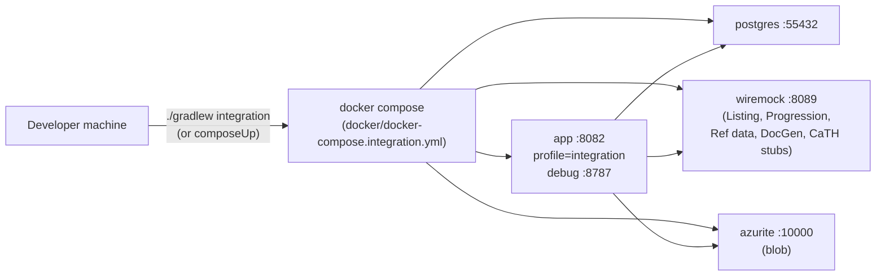

Attach a remote debugger to port **8787** to debug the running container.

### 10.4 Adding things — where to change what

| Change | Where |
|---|---|
| New endpoint / model field / enum value | OpenAPI spec repo → bump `apiSpecVersion` → implement in controller |
| Endpoint permissions | `acl/court-list-publishing-rules.drl` (+ `SecurityGroupConstants`) — no rule means **denied** |
| New list type to CaTH | `CaTHService.COURT_LIST_MAPPINGS`, transformer choice in `CourtListQueryService`, schema in `resources/schema`, `PublicationSchema` |
| New stored-PDF template | `PdfGenerationService.TEMPLATE_BY_COURT_LIST_TYPE` |
| New download type / template | `CourtListDownloadService` maps and sets |
| DB change | New Flyway file `V10xx__description.sql` (Hibernate only validates) |
| New upstream stub for tests | `src/integrationTest/resources/wiremock/mappings` + `__files` |
| New background task | Class implementing `ExecutableTask` with `@Task("NAME")`, trigger via `ExecutionService.executeWith` |

---

## 11. QA and testing guide

*For QA and developers.*

### 11.1 Test layers

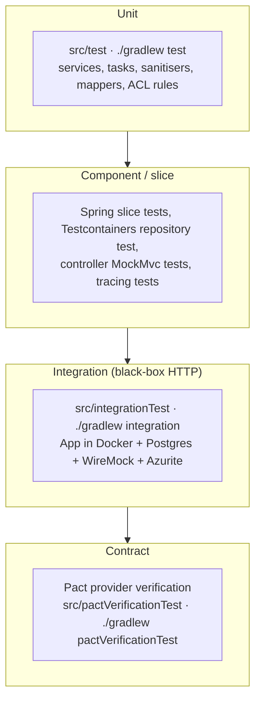

| Suite | Location | What it covers |
|---|---|---|
| Unit | `src/test/java/.../services`, `task`, `controllers`, `acl`, `cleanup` | Business logic, status rules, mappings, Drools rule behaviour |
| Repository | `CourtListStatusRepositoryTest` (Testcontainers Postgres) | Queries, constraints, migrations |
| Integration | `src/integrationTest/java/.../http/*` | End-to-end HTTP against the containerised app |
| Pact | `src/pactVerificationTest` | Provider contract with consumers (Pactflow) |

**Integration test classes**

| Test | Scenario |
|---|---|
| `CourtListPublishControllerHttpLiveTest` | Publish API validation and responses |
| `CourtListPublishAndPDFGenerationTaskIntegrationTest` | Full async publish + PDF |
| `CaTHPublishingIntegrationTest` | CaTH send and headers (via stub publisher) |
| `PdfGenerationTaskIntegrationTest`, `FileDownloadIntegrationTest` | PDF storage and download |
| `CourtListStandardPdfContentIntegrationTest`, `CourtListOnlinePublicPdfContentIntegrationTest` | PDF content per type |
| `PublishCountIntegrationTest` | `publish_count` increments |
| `SjpCourtListPublishControllerHttpLiveTest`, `SjpAsyncPublishAndBlobUploadIntegrationTest`, `SjpCaTHPayloadIntegrationTest` | SJP accept, async publish, payload shape |
| `CleanupJobIntegrationTest` | Retention cleanup (retention set to 7 days in compose) |
| `ActuatorHttpLiveTest` | Health / info endpoints |

### 11.2 Test environment

The integration stack sets `SPRING_PROFILES_ACTIVE=integration`, `CATH_PUBLISHING_ENABLED=true`, `AZURE_STORAGE_ENABLED=true`, authz/audit **off**, and system user `11111111-1111-1111-1111-111111111111`. All upstream services (Listing, Progression, Reference data, usersgroups, Document Generator, CaTH) are WireMock stubs in `src/integrationTest/resources/wiremock`.

### 11.3 Scenario checklist

| # | Scenario | Expected |
|---|---|---|
| T-1 | Publish `STANDARD` for a valid court/date | 200, `REQUESTED`; shortly after publish `SUCCESSFUL`, file `SUCCESSFUL`, `fileId` set |
| T-2 | Publish `ONLINE_PUBLIC` for a Welsh court | CaTH `x-language: WELSH`, Welsh PDF template |
| T-3 | Publish with `startDate ≠ endDate` | 400 "Start date and end date must be the same" |
| T-4 | Publish without `CJSCPPUID` | 400 "CJSCPPUID header is required" |
| T-5 | Publish same court/date/type twice | Same `courtListId`; status reset to `REQUESTED`, then re-processed |
| T-6 | Publish an unsupported type (e.g. `BENCH`) | Publish `FAILED` (unsupported type), file `FAILED` (no template) |
| T-7 | CaTH returns 4xx/5xx | Publish `FAILED`, error message stored, PDF still produced |
| T-8 | `CATH_PUBLISHING_ENABLED=false` | Publish stays `REQUESTED`; file `SUCCESSFUL` |
| T-9 | Payload contains `../` | Pattern stripped before sending; publish succeeds |
| T-10 | Query status by `courtListId` that doesn't exist | 200 with empty list |
| T-11 | Query status with `courtCentreId` but no `publishDate` | 400 |
| T-12 | Download `PUBLIC`/`STANDARD`/`BENCH` (magistrates') | PDF from Progression |
| T-13 | Download `USHERS_MAGISTRATE` | Word `.docx` |
| T-14 | Download Crown `FIRM` | Uses week-commencing dates; `CrownFirmList` template |
| T-15 | Download with `courtListType=PRISON` | 400 — must use `/prison/download` |
| T-16 | Download with `endDate < startDate` | 400 |
| T-17 | Download file by unknown `fileId` | 404 |
| T-18 | SJP publish with empty `readyCases` | `ACCEPTED`, "nothing to publish", no row created |
| T-19 | SJP press list | `CLASSIFIED`, press schema, `reportingRestriction` present on every offence |
| T-20 | SJP publish twice same day/type/language | Same row reused |
| T-21 | Cleanup with old rows | Rows + blobs older than retention deleted; 202 `{success:true}` |
| T-22 | Authz on, user without permission | 403 for that action |

### 11.4 How to inspect results

- **Status:** `GET /api/court-list-publish/publish-status?courtListId=…`, or query the DB (`court_list_publish_status`) on `localhost:55432` (db/user/password `courtlistpublishing`).
- **CaTH payload:** blob `{courtListId}-cath.json` in Azurite, or WireMock request journal (`http://localhost:8089/__admin/requests`).
- **PDF:** `GET /api/files/download/{fileId}` or blob `{fileId}.pdf`.
- **Logs:** `docker logs CP_CLP_app_it`; search for `PUBLISHING_FAILED`.

---

## 12. Operations and support

*For support and operations.*

| Topic | Detail |
|---|---|
| Health | `/courtlistpublishing-service/actuator/health` (liveness/readiness probes enabled) |
| Metrics | `/actuator/prometheus`, tagged `service=cp-court-list-publishing-service`, `cluster`, `region` |
| Tracing | OTLP export when `OTEL_METRICS_ENABLED=true`; `TracingFilter` adds trace ids to logs |
| Logs | JSON (Logback + logstash encoder); App Insights agent config in `lib/applicationinsights.json` |
| Alerting | All publish/PDF failures log the marker **`PUBLISHING_FAILED`** — build alerts on it |
| Retention | Call `publish-status-cleanup` on a schedule (system user); default 90 days |
| Blob naming | PDF: `{fileId}.pdf` (fileId = courtListId); CaTH copy: `{courtListId}-cath.json` |

**Troubleshooting**

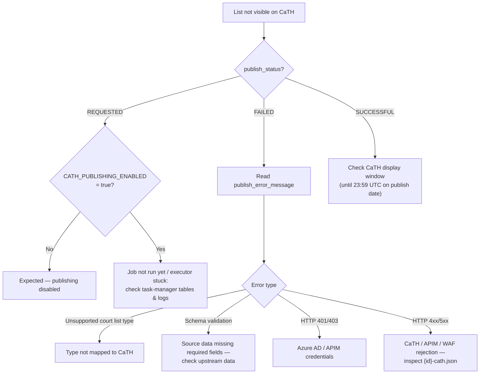

---

## 13. CI/CD pipeline

*For developers and operations.*

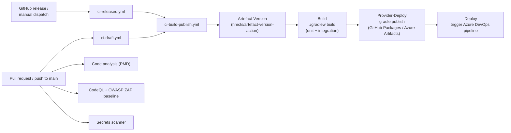

| Workflow | Trigger | Purpose |
|---|---|---|
| `ci-draft.yml` | PR / push to `main` | Non-release build and publish |
| `ci-released.yml` | Release / manual | Release build and publish |
| `ci-build-publish.yml` | Reusable | Version → build (incl. integration tests) → publish artefact → trigger ADO deploy |
| `code-analysis.yml` | PR | PMD (`.github/pmd-ruleset.xml`) |
| `codeql.yml` | PR / schedule | CodeQL and ZAP baseline |
| `secrets-scanner.yml` | PR / schedule / manual | Secret detection (`.gitleaksignore` for known-safe values) |

The container image (`Dockerfile`) is based on `eclipse-temurin:25-jre`, copies the boot jar and the App Insights config, and runs `java -jar /opt/app/app.jar`.

---

## 14. Glossary

| Term | Meaning |
|---|---|
| **CaTH** | Courts and Tribunals Hearings — the GOV.UK service that displays court lists to the public and press (a.k.a. Publishing Hub). |
| **APIM** | Azure API Management — the gateway the service calls to reach CaTH. |
| **WAF** | Web Application Firewall in front of APIM; blocks certain patterns such as `../`. |
| **Common Platform (CP)** | HMCTS's digital case management platform for criminal courts. |
| **Court centre** | A court building/location, identified by a UUID in reference data. |
| **Crown Court** | Court for serious criminal cases; identified here by `oucodeL1Code = "C"`. |
| **Magistrates' court** | Court for less serious criminal cases; uses Standard, Public, Bench lists. |
| **SJP** | Single Justice Procedure — minor offences decided by a single magistrate on the papers; lists are national. |
| **Full / delta list** | A full list contains all cases; a delta contains only changes since the last send. |
| **Restricted** | Variant of a list with reporting-restricted information filtered out. |
| **CJSCPPUID** | Header carrying the Common Platform user id of the caller. |
| **DtsMeta** | Metadata sent to CaTH as `x-*` headers (list type, court, language, sensitivity, display window). |
| **Sensitivity** | `PUBLIC` (anyone) or `CLASSIFIED` (verified users such as press/professionals) in CaTH. |
| **Task manager** | Library providing a database-backed background job queue (`ExecutionService`, `@Task`). |
| **Drools** | Rules engine evaluating the `.drl` access-control rules. |
| **Azurite / WireMock** | Local emulators for Azure Blob Storage and HTTP services in tests. |
| **Pact** | Consumer-driven contract testing framework. |